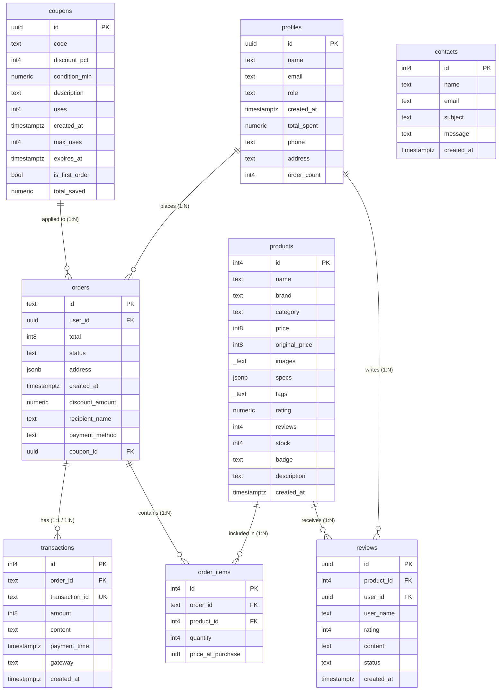

# BÁO CÁO CHI TIẾT DỰ ÁN PIXELVAULT

## 1. THÔNG TIN CHUNG
- **Tên dự án:** PixelVault - Hệ thống Cửa hàng Máy ảnh Kỹ thuật số.
- **Mục tiêu:** Xây dựng một nền tảng thương mại điện tử chuyên nghiệp, hiện đại, phục vụ việc bán lẻ máy ảnh, ống kính và phụ kiện. Hệ thống hỗ trợ thanh toán tự động, quản trị tập trung và tương tác thời gian thực cùng với Trợ lý AI.
- **Mô hình hoạt động:** Client-Serverless.

---

## 2. CÔNG NGHỆ VÀ CÔNG CỤ SỬ DỤNG
- **Frontend (Giao diện người dùng):** 
  - HTML5, CSS3 (Vanilla, thiết kế giao diện UI/UX cao cấp, Glassmorphism, Micro-animations).
  - JavaScript (ES6+).
  - PWA (Progressive Web App) hỗ trợ cài đặt ứng dụng web lên thiết bị di động/desktop.
- **Backend & Database (Hệ thống máy chủ & CSDL):** 
  - **Supabase:** Sử dụng làm Backend-as-a-Service (BaaS). Cung cấp cơ sở dữ liệu quan hệ, API tự động, xác thực người dùng và phân quyền chi tiết (Row Level Security - RLS).
  - **PostgreSQL:** Quản trị cơ sở dữ liệu lưu trữ dữ liệu sản phẩm, đơn hàng, người dùng.
  - **Supabase Realtime:** Kết nối WebSocket để lắng nghe và cập nhật trạng thái thanh toán/đơn hàng theo thời gian thực (đặc biệt trong thanh toán mã QR).
- **Dịch vụ tích hợp bên thứ ba (Third-party APIs):**
  - **Google Gemini API:** Tích hợp mô hình Ngôn ngữ lớn (LLM) để xây dựng Trợ lý ảo AI Chatbot tư vấn khách hàng tự động 24/7 trực tiếp trên website.
  - **EmailJS:** Tự động hóa quá trình tạo và gửi email hóa đơn điện tử, xác nhận đơn hàng tới khách hàng.
  - **VietQR API:** Tự động tạo mã QR thanh toán động với số tiền và nội dung chuyển khoản chính xác dựa trên mã đơn hàng.
  - **Sepay / Webhook:** Lắng nghe biến động số dư ngân hàng qua Webhook để tự động thay đổi trạng thái đơn hàng (từ `pending` sang `paid`) và lưu vào bảng giao dịch.

---

## 3. CÁC CHỨC NĂNG CHÍNH

### 3.1. Phân hệ Khách hàng (Customer)
- **Tài khoản cá nhân:** Đăng ký, Đăng nhập (tích hợp Supabase Auth), cập nhật hồ sơ cá nhân (`profiles`).
- **Khám phá sản phẩm:** Xem danh sách, lọc theo danh mục, tìm kiếm và phân trang thông minh.
- **Giỏ hàng & Thanh toán:**
  - Quản lý giỏ hàng với giao diện Slide-out Cart mượt mà.
  - Áp dụng mã giảm giá (`coupons`), hỗ trợ linh hoạt các điều kiện như: đơn hàng tối thiểu, người dùng mới, giới hạn lượt dùng.
  - Hệ thống tự động chặn lỗi số tiền âm (cấn trừ phần giảm giá dư thừa vào phí vận chuyển để đưa hóa đơn về tối thiểu `0đ`).
  - Lựa chọn thanh toán: COD hoặc Chuyển khoản ngân hàng. Tính năng **tự động vô hiệu hóa** tùy chọn thanh toán chuyển khoản nếu giá trị đơn hàng < 10.000đ.
- **Thanh toán thời gian thực:** Quét mã VietQR. Trình duyệt liên tục duy trì kết nối tới Supabase Realtime, khi nhận được tín hiệu webhook báo tiền đã vào tài khoản, màn hình sẽ tự động xác nhận và thông báo thanh toán thành công.
- **Tương tác khách hàng:** Để lại đánh giá sản phẩm (`reviews`), liên hệ hỗ trợ (`contacts`), và đặc biệt là hệ thống **AI Chatbot (Gemini API)** hỗ trợ tư vấn 1-1 chuyên sâu.

### 3.2. Phân hệ Quản trị viên (Admin)
- **Bảng điều khiển (Dashboard):** Hiển thị tổng quan doanh thu, số lượng đơn đặt, tỷ lệ thành công.
- **Quản lý đơn hàng (`orders`):** Cập nhật trạng thái đơn, in hóa đơn.
- **Quản lý sản phẩm (`products`):** Thêm mới, chỉnh sửa, xóa và kiểm soát số lượng kho (`stock`).
- **Quản lý mã giảm giá (`coupons`):** Thống kê số lượng lượt dùng mã, số tiền đã tiết kiệm được (`total_saved`), tạo/xóa các chiến dịch khuyến mãi mới.
- **Phân quyền dữ liệu (RLS):** Bảng CSDL được thiết lập lớp khóa chặt chẽ, chỉ cho phép admin quyền thêm/sửa/xóa sản phẩm, duyệt đơn, và xem thông tin bảo mật.

---

## 4. SƠ ĐỒ USE CASE (LƯỢC ĐỒ TƯƠNG TÁC)

```mermaid
usecaseDiagram
    actor KháchHàng
    actor QuảnTrịViên
    actor HệThốngThanhToán
    actor AI_Gemini

    package "PixelVault System" {
        KháchHàng --> (Đăng ký / Đăng nhập)
        KháchHàng --> (Tìm kiếm & Đánh giá SP)
        KháchHàng --> (Thêm vào Giỏ hàng)
        KháchHàng --> (Đặt hàng & Áp mã giảm giá)
        KháchHàng --> (Thanh toán VietQR / COD)
        KháchHàng --> (Trò chuyện với AI Chatbot)

        (Trò chuyện với AI Chatbot) .-> AI_Gemini : request
        
        HệThốngThanhToán --> (Gửi tín hiệu Webhook)
        (Gửi tín hiệu Webhook) .-> (Cập nhật trạng thái tự động) : include
        (Gửi tín hiệu Webhook) .-> (Lưu Giao dịch) : include
        
        QuảnTrịViên --> (Đăng nhập Admin)
        QuảnTrịViên --> (Báo cáo Doanh thu)
        QuảnTrịViên --> (Quản lý Đơn hàng)
        QuảnTrịViên --> (Quản lý Sản phẩm)
        QuảnTrịViên --> (Quản lý Khuyến mãi)
    }
```

---

## 5. ERD - SƠ ĐỒ THỰC THỂ LIÊN KẾT & CÁC MỐI QUAN HỆ

### 5.1. Mô tả chi tiết các mối quan hệ (Relationships)
Cơ sở dữ liệu của PixelVault được chuẩn hóa với các mối quan hệ dữ liệu cốt lõi sau:

1. **Người dùng (profiles) và Đơn hàng (orders):** Mối quan hệ **1 - N (One-to-Many)**.
   - Một người dùng (`profiles`) có thể tạo nhiều đơn đặt hàng (`orders`). Mỗi đơn hàng (`orders.user_id`) thuộc về duy nhất một người dùng.
2. **Người dùng (profiles) và Đánh giá (reviews):** Mối quan hệ **1 - N (One-to-Many)**.
   - Một khách hàng có thể viết nhiều bài đánh giá, nhưng mỗi bài đánh giá (`reviews.user_id`) chỉ do một người viết.
3. **Sản phẩm (products) và Đánh giá (reviews):** Mối quan hệ **1 - N (One-to-Many)**.
   - Một sản phẩm có thể nhận được rất nhiều đánh giá từ khách hàng.
4. **Đơn hàng (orders) và Chi tiết đơn hàng (order_items):** Mối quan hệ **1 - N (One-to-Many)**.
   - Một đơn đặt hàng (`orders`) bao gồm nhiều mặt hàng (chi tiết đơn). Mỗi chi tiết đơn (`order_items.order_id`) liên kết trực tiếp tới một đơn hàng mẹ.
5. **Sản phẩm (products) và Chi tiết đơn hàng (order_items):** Mối quan hệ **1 - N (One-to-Many)**.
   - Một sản phẩm cụ thể (`products`) có thể nằm trong nhiều chi tiết đơn hàng của nhiều khách hàng khác nhau (`order_items.product_id`).
6. **Mã giảm giá (coupons) và Đơn hàng (orders):** Mối quan hệ **1 - N (One-to-Many)**.
   - Một mã giảm giá có thể được áp dụng cho nhiều đơn hàng khác nhau (`orders.coupon_id`).
7. **Đơn hàng (orders) và Giao dịch (transactions):** Mối quan hệ **1 - N (One-to-Many) hoặc 1 - 1 (One-to-One)**.
   - Một hóa đơn thường tương ứng với một giao dịch chuyển khoản thành công (`transactions.order_id`).

### 5.2. Sơ đồ thực thể ERD



---

## 6. PHÂN QUYỀN BẢO MẬT (ROW LEVEL SECURITY - RLS)
Hệ thống tích hợp quy tắc RLS của Supabase nhằm đảm bảo bảo mật dữ liệu ở cấp độ bảng, cụ thể như sau:
- **profiles:** Người dùng chỉ có quyền Xem (Select), Cập nhật (Update), và Thêm mới (Insert) đúng vào bản ghi có UUID của chính họ (Ràng buộc: `auth.uid() = id`). Bất kỳ ai cũng có thể tìm kiếm dữ liệu public, nhưng không thể can thiệp vào profile người khác.
- **orders & order_items:** Người dùng chỉ xem được các đơn hàng mình đã đặt (`auth.uid() = user_id`). Quản trị viên (`role = 'admin'`) có toàn quyền Xem và Cập nhật (Update trạng thái). Tuy nhiên không ai có quyền xóa (Delete) hóa đơn đã tạo, để đảm bảo tính toàn vẹn tài chính.
- **products:** Tất cả mọi người (public) đều có quyền đọc/xem danh sách sản phẩm. Chỉ riêng Quản trị viên mới được Thêm/Sửa/Xóa dữ liệu gốc của sản phẩm.
- **coupons:** Người dùng có quyền đọc (để áp mã) và cập nhật số lượt sử dụng mã.
- **reviews & contacts:** Bất kỳ ai cũng có quyền thêm mới phản hồi, đánh giá, nhưng không có quyền ghi đè nội dung của người khác.

---

## 7. QUY TRÌNH HOẠT ĐỘNG THANH TOÁN (PAYMENT FLOW)

1. Khách hàng lựa chọn Sản phẩm $\rightarrow$ Hệ thống lưu danh sách tạm vào LocalStorage/State.
2. Khách hàng tiến hành Checkout $\rightarrow$ Hệ thống tra cứu bảng `coupons` để kiểm tra logic giảm giá và gán `coupon_id`.
3. Hệ thống sinh bản ghi vào bảng `orders` và nhiều bản ghi chi tiết vào `order_items` với trạng thái `pending`. Trừ số lượng tồn kho (`stock`) trong bảng `products`.
4. Nếu chọn COD: Chốt đơn và gọi API của EmailJS gửi Hóa đơn điện tử.
5. Nếu chọn Chuyển khoản (VietQR): 
   - Tự động sinh chuỗi mã QR có chứa `order_id` và số tiền chính xác cần chuyển.
   - Trình duyệt lắng nghe thay đổi thông qua WebSocket (Supabase Realtime) trên bảng `orders`.
   - Ngân hàng nhận tiền $\rightarrow$ Kích hoạt Webhook Sepay $\rightarrow$ Ghi log vào bảng `transactions` $\rightarrow$ Tự động sửa status trong bảng `orders` thành `paid`.
   - Client bắt được tín hiệu Realtime $\rightarrow$ Chuyển hướng màn hình thông báo Thành công & Gọi EmailJS gửi hóa đơn.
